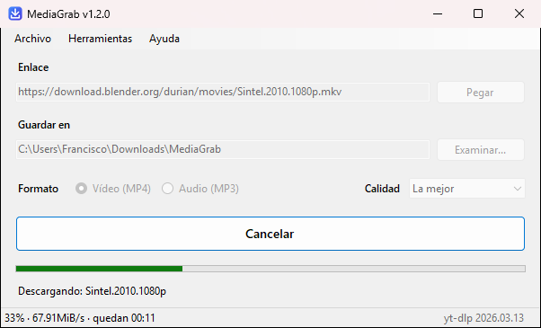

<p align="center">
  
</p>

<h1 align="center">MediaGrab</h1>

<p align="center">
  <a href="https://github.com/FranciscoFdez05/MediaGrab/releases/latest"></a>
  <a href="https://github.com/FranciscoFdez05/MediaGrab/actions/workflows/ci.yml"></a>
  
  
  <a href="LICENSE"></a>
</p>

MediaGrab descarga vídeo (MP4) o audio (MP3) desde cualquier URL compatible con [yt-dlp](https://github.com/yt-dlp/yt-dlp): YouTube, Vimeo, Twitch, redes sociales, enlaces directos a archivos y [miles de sitios más](https://github.com/yt-dlp/yt-dlp/blob/master/supportedsites.md). Es una aplicación de escritorio para Windows: pegas el enlace, eliges carpeta y formato, y descargas.

<p align="center">
  
</p>

## ✨ Características
- 🔗 Descarga desde cualquier URL que soporte yt-dlp
- 🎶 Vídeo MP4 o audio MP3, eligiendo la calidad (de 360p a la mejor disponible, o de 128 a 320 kbps)
- 📋 Pega el enlace con un clic, arrástralo desde el navegador o deja que se rellene solo al copiarlo
- 📊 Progreso en tiempo real con velocidad y tiempo restante, también en el icono de la barra de tareas
- ⏹️ Cancela una descarga en curso con el mismo botón o con `Esc`
- 📂 Al terminar, abre la carpeta con el archivo ya seleccionado
- 💾 Recuerda la carpeta, el formato y la calidad que usaste la última vez
- 🔧 Detecta, instala (winget o pip) y actualiza yt-dlp desde la propia app
- 🖥️ Nítida en pantallas de alta resolución y al moverla entre monitores

## 🖥️ Requisitos
- Windows 10 u 11 de 64 bits
- [yt-dlp](https://github.com/yt-dlp/yt-dlp): la app ofrece instalarlo si no lo encuentra
- [ffmpeg](https://ffmpeg.org/): necesario para unir vídeo y audio y para convertir a MP3 (winget lo instala junto a yt-dlp)

Para instalarlos manualmente:
```
winget install yt-dlp
```

## ⚙️ Instalación
Descarga la última versión desde [Releases](https://github.com/FranciscoFdez05/MediaGrab/releases):
- **`MediaGrab-vX.Y.Z-win-x64.exe`** (recomendado): lo lleva todo incluido. Descárgalo y ábrelo; no hay que instalar nada más.
- **`MediaGrab-vX.Y.Z-win-x64-ligero.exe`**: ocupa mucho menos, pero necesita tener instalado el [.NET Desktop Runtime 10](https://dotnet.microsoft.com/download/dotnet/10.0). Si no lo tienes, Windows te lo pedirá al abrirlo.
- **`SHA256SUMS.txt`**: hashes para comprobar que la descarga no se ha alterado.

MediaGrab es portable: no se instala y guarda sus preferencias en `%APPDATA%\MediaGrab`. Windows SmartScreen puede avisar la primera vez porque el ejecutable no está firmado: pulsa *Más información* → *Ejecutar de todas formas*.

También puedes clonar el proyecto y [compilarlo](#-compilar):
```
git clone https://github.com/FranciscoFdez05/MediaGrab.git
```

## 📋 Uso
1. Copia un enlace y vuelve a MediaGrab: se pega solo. También puedes usar `Pegar` o arrastrarlo a la ventana.
2. Elige la carpeta en `Guardar en` (con `Examinar...` o escribiendo la ruta).
3. Selecciona `Vídeo (MP4)` o `Audio (MP3)` y la `Calidad`.
4. Pulsa `Descargar` (o Enter). Mientras descarga, el botón pasa a `Cancelar` (o pulsa `Esc`).
5. Al terminar, `Mostrar en la carpeta` abre el archivo descargado. Si algo falla, `Ver detalles` muestra el motivo.

La versión de yt-dlp aparece en la esquina inferior derecha. Desde el menú `Herramientas` puedes comprobarlo, instalarlo o actualizarlo.

> 💡 Si las descargas de un sitio empiezan a fallar (por ejemplo, con *HTTP Error 403*), casi siempre se arregla con `Herramientas > Actualizar yt-dlp`: los sitios cambian a menudo y yt-dlp se actualiza para seguirlos.

## 🏗️ Estructura del proyecto
```
MediaGrab/
├── src/MediaGrab/                  Código de la aplicación
│   ├── Program.cs                  Punto de entrada y manejo global de errores
│   ├── UI/
│   │   ├── MainForm.cs             Ventana principal: validación, estado y mensajes
│   │   ├── Theme.cs                Colores y estilo de los botones
│   │   ├── TaskbarProgress.cs      Progreso en el icono de la barra de tareas
│   │   └── NativeMethods.cs        Texto de ejemplo y parpadeo de la ventana
│   ├── Services/
│   │   ├── YtDlpLocator.cs         Localiza yt-dlp (PATH, winget, pip) con caché
│   │   ├── YtDlpInstaller.cs       Instala y actualiza yt-dlp (-U, winget, pip)
│   │   ├── YtDlpDownloader.cs      Lanza la descarga y resume los errores
│   │   └── DownloadProgressTracker.cs  Convierte la salida de yt-dlp en progreso
│   ├── Infrastructure/
│   │   ├── ProcessRunner.cs        Ejecuta procesos sin bloqueos y con cancelación
│   │   └── AppSettings.cs          Preferencias del usuario (settings.json)
│   ├── Models/                     Tipos de datos (petición, calidad, progreso, resultados)
│   ├── Assets/app.ico              Icono de la aplicación
│   └── MediaGrab.csproj            Proyecto: versión, metadatos y publicación
├── tests/MediaGrab.Tests/          Tests automáticos (xUnit)
├── docs/images/                    Logo y capturas del README
├── tools/make_logo.py              Genera el logo y el icono (requiere Pillow)
├── .github/workflows/ci.yml        Tests y compilación automática en GitHub Actions
├── build.ps1                       Tests + compilación + archivos de la release
├── global.json                     Versión del SDK de .NET
├── CHANGELOG.md                    Historial de versiones
└── MediaGrab.slnx                  Solución
```

## 🔨 Compilar
Necesitas el [SDK de .NET 10](https://dotnet.microsoft.com/download/dotnet/10.0). Para editar la interfaz con el diseñador, usa Visual Studio 2026 o posterior.

```
dotnet build          # compilar
dotnet test           # ejecutar los tests
dotnet run --project src/MediaGrab
```

Para preparar una release, desde PowerShell en la raíz del repositorio:
```
.\build.ps1
```
Ejecuta los tests y genera en `dist/` los dos `.exe`, los hashes `SHA256SUMS.txt` y las notas de la versión (`RELEASE_NOTES.md`, sacadas de [CHANGELOG.md](CHANGELOG.md)).

La versión se cambia en `src/MediaGrab/MediaGrab.csproj` (`<Version>`).

## 🤝 Contribuir
Las contribuciones son bienvenidas:
1. Haz un fork del repositorio.
2. Crea una rama (`git checkout -b feature/nueva-feature`).
3. Haz tus cambios y un commit (`git commit -am 'Añadir nueva feature'`).
4. Sube la rama (`git push origin feature/nueva-feature`).
5. Abre un Pull Request.

## ⚖️ Aviso
Descarga solo contenido que tengas derecho a descargar y respeta los términos de uso de cada sitio.

## 📄 Licencia
Distribuido bajo la licencia [MIT](LICENSE).

---

<p align="center"><b>Developed with ❤️ by <a href="https://github.com/FranciscoFdez05">Francisco</a></b></p>
