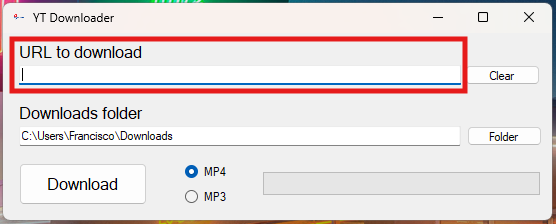
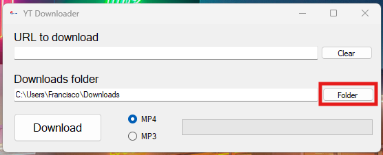
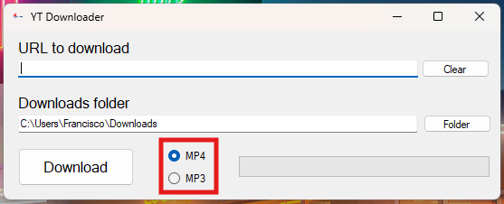
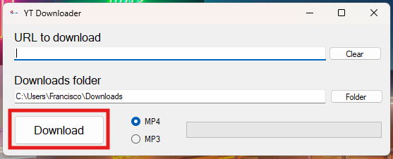
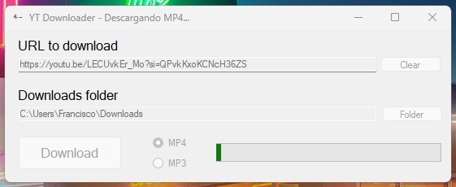
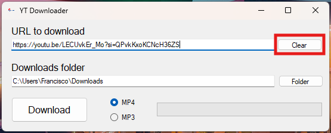

# 🛠️ YT Downloader
YT-Downloader es una aplicación de Windows From en C# que permite descargar videos de YT o de cualquier otra URL valida en formatos de video (MP4) y audio (MP3), con una interfaz intuitiva y funcional 

## ✨ Características
- 📂 Selecciona la carpeta donde se va a descargar
- 🔍 Selecciona una URL a descargar
- 🎶Elige entre MP4 o MP3
- 👤 Interfaz gráfica de usuario simple y fácil de usar.

## 🖥️ Requisitos
- .NET Framework 4.7.2 o superior
- yt-dlp
Puedes instalar yt-dlp con:
```
winget install yt-dlp
```

## ⚙️ Instalación
Podemos clonar el proyecto desde:
```
https://github.com/FranciscoFdez05/YTDownloader.git
```

o Descargar el ejecutable desde [Releases](https://github.com/FranciscoFdez05/YTDownloader/releases)


## 📋 Manual de uso
1. Pegamos la URL que queramos descargar con: `URL to download`



2. Seleccionamos la carpeta donde queramos descargar con: `Folder`



3. Seleccionamos el formato de archivo que queremos descargar



4. Para descargar pulsamos en `Download`



-  Podemos ver el progreso en la barra de progreso



- Podemos limpiar la URL con el botón `Clear`



## 🤝 Contribuir
Las contribuciones son bienvenidas. Si deseas contribuir, sigue estos pasos:
1. Haz un fork del repositorio.
2. Crea una nueva rama (`git checkout -b feature/nueva-feature`).
3. Realiza los cambios necesarios y haz commit (`git commit -am 'Añadir nueva feature'`).
4. Haz push a la rama (`git push origin feature/nueva-feature`).
5. Abre un Pull Request.

---

**Developed with ❤️ by [Francisco](https://github.com/FranciscoFdez05)**


